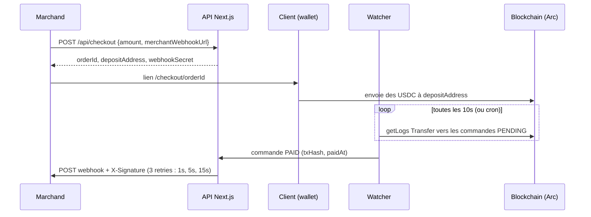

# usdc-checkout

Système de paiement en **USDC** : un marchand crée une commande, reçoit une adresse de dépôt unique, le client y envoie des USDC, un watcher détecte le paiement on-chain et notifie le marchand par **webhook signé (HMAC-SHA256)**.

Réseau cible : **Arc Testnet** (le gas s'y paie en USDC, un seul faucet suffit pour tester).

## Stack

- Next.js 14 (App Router), TypeScript, Tailwind CSS
- Prisma + PostgreSQL (Neon ou local)
- viem : dérivation HD des adresses et lecture des events `Transfer`

## Flux



Statuts d'une commande : `PENDING` → `PAID` (montant reçu >= montant attendu) ou `EXPIRED` (30 min sans paiement suffisant).

## Installation

Prérequis : Node 20+, une base PostgreSQL (par exemple un projet gratuit sur [Neon](https://neon.tech)).

```bash
npm install
cp .env.example .env      # puis remplis les valeurs (voir ci-dessous)
npx prisma migrate dev --name init
npm run dev
```

L'application est sur `http://localhost:3000` : la page d'accueil permet de créer des commandes et de suivre leur statut.

### Variables d'environnement

| Variable | Rôle |
|---|---|
| `DATABASE_URL` | Chaîne de connexion PostgreSQL (`postgresql://...`, pas l'URL REST de Neon). Pour les migrations avec Neon, utilise la connexion directe (sans `-pooler`). |
| `HD_WALLET_MNEMONIC` | Phrase de 12 mots dont sont dérivées les adresses de dépôt. **Testnet uniquement.** Génère-en une : `node -e "const a=require('viem/accounts');console.log(a.generateMnemonic(a.english))"` |
| `USDC_CONTRACT_ADDRESS` | USDC sur Arc Testnet : `0x3600000000000000000000000000000000000000` |
| `RPC_URL` | RPC d'Arc Testnet : `https://rpc.testnet.arc.io` |
| `CRON_SECRET` | Secret qui protège `/api/cron/watch` (valeur longue et aléatoire). |

## Obtenir des USDC de test

1. Ajoute **Arc Testnet** à MetaMask : chain ID `5042002`, RPC `https://rpc.testnet.arc.io`, symbole USDC, explorateur `https://explorer.testnet.arc.io`.
2. Demande des USDC sur [faucet.circle.com](https://faucet.circle.com) en choisissant le réseau **Arc Testnet**.

## Lancer le watcher

### En local

```bash
npm run dev      # terminal 1
npm run watch    # terminal 2 : un passage toutes les 10 secondes
```

Le watcher garde un curseur (`WatcherState`) du dernier bloc scanné, cherche les `Transfer` vers les commandes `PENDING`, passe les commandes payées en `PAID` (déclenchant le webhook) et les commandes périmées en `EXPIRED`.

### En production (cron)

La route `/api/cron/watch` fait un passage du watcher. Elle exige l'en-tête `Authorization: Bearer <CRON_SECRET>` et accepte GET et POST.

- **Vercel Cron** : `vercel.json` déclare un appel quotidien (`0 0 * * *`), le maximum du plan gratuit (Hobby). Vercel envoie automatiquement l'en-tête `Authorization` si la variable `CRON_SECRET` est définie. Une fréquence plus élevée demande un plan payant.
- **Gratuit et plus fréquent** : un service externe comme [cron-job.org](https://cron-job.org) (toutes les minutes) qui appelle `POST https://TON-APP.vercel.app/api/cron/watch` avec l'en-tête `Authorization: Bearer <CRON_SECRET>`.
- Un paiement n'est détecté qu'au passage suivant : avec un cron à la minute, compte jusqu'à une minute de délai.

## Déploiement (Vercel + Neon, gratuit)

1. Pousse le projet sur GitHub (ou utilise `npx vercel` en ligne de commande).
2. Importe le projet sur [vercel.com](https://vercel.com) ; le build lance `prisma generate` automatiquement (script `postinstall`).
3. Dans les paramètres du projet, ajoute les variables : `DATABASE_URL`, `HD_WALLET_MNEMONIC`, `USDC_CONTRACT_ADDRESS`, `RPC_URL`, `CRON_SECRET`. Utilise un mnemonic **différent** de celui de ton `.env` local.
4. Applique les migrations sur la base de production : `npx prisma migrate deploy` (avec `DATABASE_URL` pointant vers elle).
5. Déploie, puis configure le cron externe (section précédente).

Les URLs de webhook en `localhost` ne sont pas joignables depuis Vercel : en production, le marchand de test est `https://TON-APP.vercel.app/api/webhook-test` (préremplie dans le formulaire).

## API

### `POST /api/checkout`

```json
{ "amount": "10.5", "merchantWebhookUrl": "https://marchand.example/webhook" }
```

Réponse `201` :

```json
{
  "orderId": "cm...",
  "depositAddress": "0x...",
  "amount": "10.5",
  "expiresAt": "2026-10-16T14:05:23.784Z",
  "webhookSecret": "..."
}
```

`amount` : nombre > 0, 6 décimales maximum. `webhookSecret` n'est renvoyé qu'ici : conserve-le pour vérifier les signatures.

### `GET /api/orders/[id]`

État public d'une commande (utilisé par la page de paiement). N'expose ni le secret ni l'URL du webhook.

### Autres routes

`GET /api/orders` (liste), `POST /api/orders/[id]/resend-webhook`, `POST|GET /api/cron/watch`, `POST|GET /api/webhook-test`.

## Webhook

À chaque paiement, le marchand reçoit un `POST` :

```json
{
  "orderId": "cm...",
  "status": "PAID",
  "amount": "10.5",
  "txHash": "0x...",
  "timestamp": "2026-10-16T13:50:00.000Z"
}
```

avec l'en-tête `X-Signature` = HMAC-SHA256 hexadécimal du **corps brut**, avec le `webhookSecret` de la commande. Vérification côté marchand (Node) :

```js
import { createHmac, timingSafeEqual } from "crypto";

function isValid(rawBody, signature, secret) {
  const expected = Buffer.from(createHmac("sha256", secret).update(rawBody).digest("hex"), "hex");
  const given = Buffer.from(signature, "hex");
  return given.length === expected.length && timingSafeEqual(given, expected);
}
```

Si la réponse n'est pas un 2xx, le webhook est renvoyé jusqu'à 3 fois (après 1 s, 5 s, 15 s). Chaque tentative est enregistrée dans `WebhookLog` et visible sur `/webhook-logs`. Le bouton « Renvoyer le webhook » du dashboard relance l'envoi d'une commande payée.

## Tester sans payer

```bash
npm run simulate -- <orderId>    # passe la commande en PAID et envoie le webhook (dev uniquement)
npm run inspect -- <txHash>      # affiche les logs d'une transaction Arc (diagnostic)
```

## Scripts

| Commande | Rôle |
|---|---|
| `npm run dev` | Serveur de développement |
| `npm run watch` | Watcher local (boucle de 10 s) |
| `npm run simulate -- <orderId>` | Simule un paiement |
| `npm run inspect -- <txHash>` | Inspecte une transaction |
| `npm run build` / `npm start` | Build et serveur de production |

## Structure

```
app/page.tsx                         accueil = dashboard
app/dashboard/page.tsx               création de commande, liste, filtre, renvoi de webhook
app/checkout/[orderId]/page.tsx      page de paiement (QR code, compte à rebours, statut en direct)
app/webhook-logs/page.tsx            webhooks reçus et tentatives d'envoi
app/api/checkout/route.ts            création de commande
app/api/orders/...                   lecture des commandes, renvoi de webhook
app/api/cron/watch/route.ts          un passage du watcher
app/api/webhook-test/route.ts        faux serveur marchand (vérifie la signature)
lib/hdwallet.ts                      dérivation des adresses de dépôt
lib/watcher.ts                       détection des paiements on-chain
lib/webhook.ts                       signature HMAC, envoi et retries
prisma/schema.prisma                 Order, WebhookLog, ReceivedWebhook, WatcherState
scripts/                             watch, simulate-payment, inspect-tx
```

## Particularités d'Arc

- Le USDC est la monnaie native (gas) d'Arc. Un envoi depuis un wallet est un transfert natif qui émet un event `Transfer` standard depuis l'adresse système `0xffff…fffe`, avec la valeur en **18 décimales**. L'interface ERC-20 du contrat USDC utilise 6 décimales. Le watcher accepte les deux émetteurs et convertit selon l'émetteur.
- Les blocs durent moins d'une seconde et sont finalisés à l'inclusion.

## Limites connues

- **Pas de balayage des fonds** : les USDC restent sur les adresses de dépôt, contrôlées par le mnemonic. Aucun transfert automatique vers un wallet marchand.
- **Pas d'authentification** sur le dashboard, la création de commande et `/api/webhook-test` : à protéger avant toute mise en ligne publique.
- **Un seul transfert doit couvrir le montant** : deux paiements partiels ne s'additionnent pas.
- Un paiement arrivé juste après l'expiration, mais avant le prochain passage du watcher, est accepté.
- `merchantWebhookUrl` n'est pas filtré : en production, le serveur pourrait être poussé à appeler une adresse interne (SSRF).
- Le cron gratuit de Vercel ne passe qu'une fois par jour ; utilise un cron externe pour une détection rapide.
- Sur Neon en production, il est conseillé d'utiliser la connexion poolée pour l'application et la connexion directe pour les migrations (`directUrl` dans `schema.prisma`).
